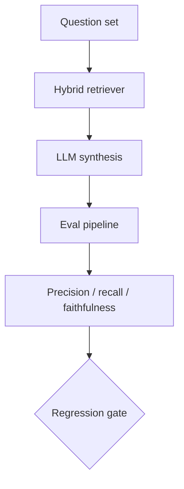

# Daily Architecture & Project Proposal
**Proposal ID:** `PROP-20261017-001` | **Date:** Saturday, October 17, 2026 | **Target Schedule:** 09:00 AM Cairo

> **Workflow rule:** this is an uncommitted local proposal. Nothing is pushed to GitHub until you explicitly approve it. The executor is the only component allowed to write to git.

---

## 🌟 Part 1: Repo Perfection Audit

### Target: `agents` — grade 34/100

- README length: 4532 chars
- Folders: 1_foundations, 2_openai, 3_crew, 4_langgraph, 5_autogen, 6_mcp, setup
- Gaps (biggest first): mermaid, tests, stack, badges, demo, structure, license

#### Recommended immediate actions
1. **mermaid** — Insert a Mermaid architecture diagram that mirrors the real component flow.
2. **tests** — Add at least one automated test that fails when behaviour breaks.
3. **stack** — Add a tech-stack table naming the frameworks actually used.
4. **badges** — Add Shields.io badges (language, framework, build, license).

---

## 🚀 Part 2: Curriculum Deep-Dive — RAG Evaluation Harness (precision, recall, faithfulness)

**Course track:** `llm_engineering` | **Topic id:** `rag-eval-harness` | **Status:** not-built

### 1. What you learn / study focus
Synthetic eval dataset generation, context precision/recall, answer faithfulness, regression gates on chunking or prompt changes.

### 2. Architecture

### 3. Tech stack
- `Python`
- `Ragas`
- `ChromaDB`
- `pytest`
- `pandas`

### 4. Step-by-step implementation plan
1. **Phase 1:** Generate a gold-standard Q/A set from your own course notes.
2. **Phase 2:** Build a hybrid retriever (dense + BM25) behind one interface.
3. **Phase 3:** Score every pipeline change with Ragas metrics and store results as JSON.
4. **Phase 4:** Add a CI-style gate that fails when faithfulness drops more than 5%.
5. **Phase 5:** Publish a short report comparing three chunking strategies.

### 5. Model-generated architecture note

The harness centers on a synthetic eval dataset generator that uses an LLM to author question-answer-context triples from your indexed corpus, persisting them as a versioned pandas DataFrame alongside the ChromaDB collection snapshot they were derived from. A Ragas-based evaluation pipeline then scores each generated item for context precision, context recall, and answer faithfulness, writing per-item and aggregate metrics into dated result artifacts for trend comparison. Finally, pytest regression gates load those artifacts and fail the build whenever a candidate chunking strategy or prompt revision drops any tracked metric below a configurable threshold relative to the last accepted baseline.

---

## ⚡ Part 3: Approval

1. **Reply to the digest email** with `approve`, `ok`, or `push to github`.
2. **One-click local link** (same machine / LAN): http://127.0.0.1:8765/approve?id=PROP-20261017-001&token=c4c777efddf7493717cba968
3. **CLI:** `python orchestrator/main.py approve --id PROP-20261017-001 --decision approved`

If you do nothing, this stays a local draft forever. Rejection is honoured: `--decision rejected`.

> **Protected repos:** `YousefAlsayed-DigitalTwin` is never pushed by the approval flow. A manual `execute --id <id> --allow-protected` is required if you ever want it pushed.
